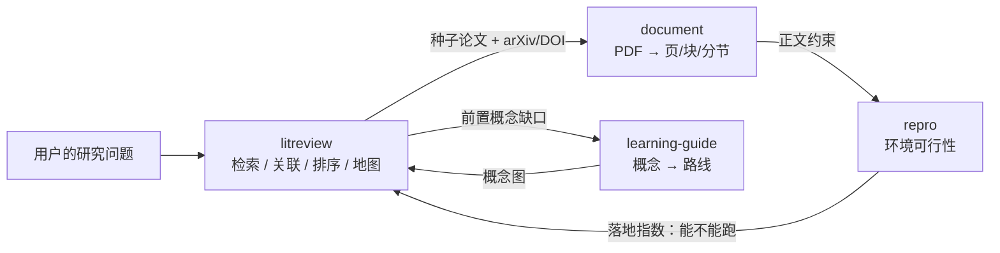

# yantu 论文检索与文献关联（paper-research）· 技术方案提案

> 面向：需要判断「文献模块要不要开工、从哪开工、接到哪个模块上」的技术决策者
> 交付范围：分支现状核查 · 能力边界 · 开源借鉴 · 数据契约 · 工具与 CLI 设计 · 创新点 · 分阶段路线 · 可视化方案
> 版本：基于 `main@7ecc165`、`document-processing@2c9136a`、`learning-guide@3798eca` 三个 commit 的实测代码，2026-11-05
> 状态：**提案初稿**。凡带「实测」字样的数字均为本机当日验证；推断项已标注，未验证的不写成结论。

**取材与可信度说明**

| 类别 | 来源 | 可信度 |
| --- | --- | --- |
| 分支状态、文件结构、既有代码写法 | `git ls-remote` + 本地 clone 逐文件阅读 | 高（可直接复核） |
| 开源项目的星数与活跃度 | GitHub API 实时查询 | 高（会随时间变化） |
| 各学术 API 的可用性 | 本机 2026-11-05 实测（见 §10.6） | 高（但换机器/换时段会不同） |
| 创新点的效果 | 尚未实现，属设计主张 | 中（标注为待验证） |

> 目标：给「研途」补上第三块能力——**学术检索 + 文献关联**。
> 前提：不重复造 PDF 解析、不重复造环境判定，只做「发现问题 → 找到文献 → 排出优先级 → 给出可核验的结论」。

---

## 0. 实现状态（2026-11-05 更新，与本文档正文对应）

正文是开工前的提案。**P0 已落地**，落地过程中与提案有出入的地方记在这里，避免文档和代码对不上：

| 提案项 | 状态 | 落地位置 / 与提案的差异 |
| --- | --- | --- |
| 数据契约 | ✅ 已实现 | `research_agent/litreview/spec.py`；`PaperRef` 多一个 `cited_known`（见下） |
| 跨源身份对齐 | ✅ 已实现 | `identity.py`：DOI > arXiv > openalex > 标题指纹；模糊匹配**只标不并** |
| 多源降级链 | ✅ 已实现 | `sources/`（arxiv / openalex / crossref）+ `search.Coverage` |
| 检索层主题过滤 | ✅ 已实现 | `search.relevance()`，零分丢弃并报数（对应实测的 Crossref 跑偏问题） |
| 可复现检索（快照） | ✅ 已实现 | `search.save_snapshot` / `load_snapshot` |
| 引用关系图 | ✅ 已实现 | `graph.expand()`：cites / cited_by / similar / coupling 四种边分离 |
| 四档阅读建议 | ✅ 已实现 | `triage.py`：read_now / skim / park / drop，信号可核对 |
| 证据分级 L1/L2/L3 贯穿综述 | ⏳ 未做 | 现状只到「每条结果带来源」，尚未做段落级证据标注 |
| 引用语境分型（S2 `contexts`） | ⏳ 未做 | S2 无 key 时稳定 429，暂不纳入降级链；需要 key 才能做支持/对比/借用/背景四型 |
| 最小阅读集 + 前置概念缺口 | ⏳ 部分 | `triage` 会按概念库做「可能的前置概念」弱提示，未做真正的最小集合求解 |
| 落地指数（接 repro） | ⏳ 未做 | 需要先把 `repro` 的环境判定接进检索排序 |

**落地中修正的两个设计错误**（比提案更保守，理由见代码注释）：

1. **被引不能按批内最大值归一**——批内第一名永远满分，一篇 1 次引用的新论文会被判「奠基工作」。
   改成绝对标尺：1 万次 = 1.0，100 次 ≈ 0.5。
2. **未知被引不能当 0**——arXiv 不返回被引数，当 0 会让所有预印本被系统性地压后
   （实测问 RAG，前 8 条全是 2026 年的书籍章节，arXiv 论文一条没进）。改为中性值 0.4 + 明示「未知」。

---

## 一、现状核查（有据可查）

拉取远端引用确认（`git ls-remote`）：

| 分支 | commit | 与 main 的关系 |
| --- | --- | --- |
| `main` | `7ecc165` | — |
| `paper-research` | `7ecc165` | **与 main 完全一致，0 提交、0 差异** |
| `research-memory` | `7ecc165` | 同样为空分支 |
| `document-processing` | `2c9136a` | +1394 行，PDF 解析 / 引文回验 |
| `learning-guide` | `3798eca` | +6177 行，学习路线 / 概念库 |

另外 GitHub 上没有开任何 PR（`pulls?state=all` 返回 0）。

**结论：`paper-research` 确实只是从 main 拉出来的空分支，一行代码都没有。**

同时发现两个会影响动手顺序的事实：

1. **`paper` 这个 CLI 命名空间已经被复现模块占用了**（`cli.py paper scan|diff|report`）。新分支不能再叫 `paper`，否则命令冲突。
2. **`repro/paper_adapter.py` 已经存在**（在 document-processing 分支里），做的是「论文正文 → 环境需求」的桥接。新模块若也叫 `paper_*`，代码上会和它语义打架。
   → 建议新模块统一命名为 **`litreview`**，CLI 用 **`lit`**，工具前缀 `lit_*`。

---

## 二、职责边界：它应该待在哪一层

现有两个模块的哲学是「**事实由工具取，模型只负责解释**」。第三块必须沿用，否则会退化成一个会编参考文献的 ChatGPT。



分工一句话：

- `document` 负责**读**（文本、分节、引文回验）
- `litreview` 负责**找 + 连 + 排**（检索、身份对齐、引用图、阅读优先级）
- `repro` 负责**判**（能不能复现）
- `learning-guide` 负责**教**（前置知识怎么补）

**明确不做的事**（避免和另外两个分支撞车）：

- 不解析 PDF（调 `document.extract`）
- 不算环境差距（调 `repro.diff`）
- 不写长综述正文（新手要的是一张能看懂的地图，不是 20 页凑字数的 Related Work）
- 不爬 Google Scholar（ToS + 封 IP，不值得）

---

## 三、先借鉴：开源项目取什么、弃什么

| 项目 | 状态（2026-11 实测） | 该借的 | 不该借的 |
| --- | --- | --- | --- |
| `openags/paper-search-mcp` | 3.0k★，活跃 | 多源适配层（arXiv / PubMed / bioRxiv / Crossref / OpenAlex / S2）、统一返回结构、按源暴露能力差异 | 以「下载 PDF」为主路径（体积大、版权灰、国内网慢）；我们**元数据优先** |
| `blazickjp/arxiv-mcp-server` | 3.3k★，活跃 | **本地优先**（papers stay on disk）、LaTeX 分节读、BibTeX 导出、**topic watch** 订阅新论文 | 只绑 arXiv 单源 |
| `Future-House/paper-qa` | 9.5k★ | **evidence-gated 生成**：答案必须锚定原文片段，引文回验不通过就丢掉 | 它的重型 RAG 索引链路（我们要先图后向量） |
| `assafelovic/gpt-researcher` | 30k★ | planner / executor 分离、多源并行、报告模板 | 一上来就放飞式长文写作 |
| `LearningCircuit/local-deep-research` | 9.5k★ | 按问题复杂度选检索策略、10+ 引擎、本地模型可跑、离线友好 | 依赖重型本地推理栈 |
| `bytedance/pasa` | 1.7k★（研究原型） | **search + 引用回溯双工具**的 snowballing 思想：从高被引论文的参考文献里滚雪球，召回高、成本低 | RL 训练那套，工程上不现实 |
| `J535D165/pyalex` / `danielnsilva/semanticscholar` | 430★ / 485★ | 只借鉴它们的字段名与分页约定，**不引依赖**（本项目目前标准库零依赖，要保持） | — |

数据底座（这四家的能力差异决定了降级链的顺序）：

| 源 | 关键能力 | 限制（2026-11 核实） |
| --- | --- | --- |
| **OpenAlex** | `referenced_works` / `cited_by` / `related_works` / 三级主题；覆盖最全，含非英文 | 免费额度约 $1/天，规模化必须带 key，**游标翻页需要 key** |
| **Semantic Scholar** | citations 的 **`contexts`（引用语境原文）**、`intents`、SPECTER2 向量、`recommendations`、`batch` 端点 | 无 key 是共享池（约 1000 RPS 全体共享，会被限流）；带 key 仅 **1 RPS** |
| **Crossref** | DOI 权威登记，元数据最准 | 无引用网络（只能靠 `reference` 字段，且不完整） |
| **arXiv** | 最新预印本、比正式发表早 6~18 个月 | 单源、约 3 秒/请求的礼节性限速、无引用关系 |

> 现实约束要写进设计：README 里已经记录过「GitHub 直连 TLS 握手失败」。国内网络下 OpenAlex/S2 都可能不稳，所以**降级链 + 本地缓存**不是锦上添花，是必需项。

---

## 四、数据契约（`research_agent/litreview/spec.py`）

沿用 `repro/spec.py` 的风格：dataclass + `to_dict()` + 枚举带 `label`。核心是**每个对象都能说清「我从哪来」**。

```python
@dataclass
class PaperRef:
    """一篇文献的最小标识。source/source_id 缺一不可。"""
    source: str                  # arxiv | openalex | s2 | crossref
    source_id: str               # arXiv:2401.01234 / W2741809807 / DOI:10.1145/...
    title: str
    authors: list[str]
    year: int | None
    venue: str = ""
    abstract: str = ""
    url: str = ""
    pdf_url: str = ""
    cited_by_count: int = 0
    is_survey: bool = False      # 标题/venue 命中综述特征
    fields: list[str] = field(default_factory=list)
    fetched_at: str = ""         # ISO8601，带时区
    raw_ref: str = ""            # 原始响应在缓存里的键
```

```python
@dataclass
class Identity:
    """跨源对齐后的规范身份。对齐过程必须可解释，不合并有疑问的条目。"""
    canonical_key: str           # doi:10.xxxx | arxiv:2401.01234 | title:<指纹>
    doi: str = ""
    arxiv_id: str = ""
    openalex_id: str = ""
    s2_id: str = ""
    match_method: str = ""       # doi | arxiv | title_fuzzy | single_source
    confidence: str = "high"     # high | medium | low
    possible_duplicates: list[str] = field(default_factory=list)
```

```python
@dataclass
class Retrieval:
    """一次检索的完整现场。这是「可复现检索」的基础。"""
    question: str
    queries: list[str]           # 实际发给各源的检索式
    filters: dict                # year_from / fields / min_citations
    sources: list[str]
    started_at: str
    finished_at: str
    coverage: dict               # {tried, ok, failed, degraded}
    results: list[PaperRef]
    snapshot_key: str            # 压缩快照，落盘可重放
```

```python
@dataclass
class Edge:
    src: str
    dst: str
    relation: str                # cites | cited_by | similar | same_author | same_venue
    provenance: str              # 哪个源的第几次请求
    intent: str = ""             # background | method | result | contrast（来自 S2 contexts）
    context: str = ""            # 引用语境原文片段，≤200 字
```

```python
@dataclass
class TriageVerdict:
    key: str
    verdict: str                 # READ_NOW | SKIM | PARK | DROP
    reason: str                  # 必须能指回信号（被引/年份/综述/有代码/矛盾边）
    read_for: str = ""           # 读它要解决什么问题
    prereq: list[str] = field(default_factory=list)   # 前置概念（接 learning-guide）
```

`EvidenceLevel`（L1 原文命中 / L2 元数据推断 / L3 模型归纳）直接从 `repro.spec` 复用，不另造一套。

---

## 五、模块结构与工具设计

```
research_agent/litreview/
├── __init__.py          # 对外出口，只暴露 search / expand / triage / lineage / map
├── spec.py              # 上面的契约
├── identity.py          # 跨源对齐 + 去重（规则明确、逐步记录 match_method）
├── cache.py             # SQLite 缓存 + 压缩快照（TTL 7 天，支持 --offline）
├── sources/
│   ├── base.py          # Source 协议：search / get / refs / cited_by / similar
│   ├── arxiv.py         # 预印本、最新前沿（3s 限速）
│   ├── openalex.py      # 引用网络主力
│   ├── s2.py            # 引用语境 contexts + recommendations + batch
│   ├── crossref.py      # DOI 校验与补全
│   └── local.py         # 本地已下载 PDF/笔记优先（先查磁盘，再走网络）
├── graph.py             # 建图、1~2 跳扩展、簇识别、代际划分
├── rank.py              # 排序：相关 × 影响 × 新鲜 × **落地**（见创新点 1）
├── triage.py            # 四档阅读建议 + read_for + prereq
├── lineage.py           # 奠基 → 转折 → 前沿（时间轴）
├── replay.py            # 从快照重放一次检索，比对差异
├── render.py            # 地图（Mermaid）、精读清单、检索报告
└── knowledge/
    └── search_strategies.json   # 检索式模板、综述识别规则、常见坑

research_agent/tools/lit_tools.py      # 薄封装，返回 dict 不抛异常
tests/test_lit.py                      # 全部基于 fixtures/*.json 离线跑
tests/fixtures/lit/                    # 预存的真实 API 响应
```

### 6 个工具（对齐 `repro_*` 的粒度）

| 工具 | 输入 | 输出 | 对应 CLI |
| --- | --- | --- | --- |
| `lit_search` | question, sources, year_from, limit | 候选列表 + coverage + 检索式 | `lit search` |
| `lit_expand` | seed, depth, relations | PaperGraph（节点 + 边 + 引用语境） | `lit expand` |
| `lit_triage` | keys, goal | 四档优先级 + 理由 + 前置概念 | `lit triage` |
| `lit_lineage` | topic, years | 奠基/转折/前沿三代 + 关键节点 | `lit lineage` |
| `lit_brief` | key | 问题-方法-结论-局限，每句带定位 | `lit brief` |
| `lit_map` | seed, out | Markdown 地图 + Mermaid 图 + 精读清单 | `lit map` |

**关键约束**：检索和作答必须是两个工具。模型不许在一次调用里「顺手把答案也写了」——否则引用一定编。

---

## 六、创新点（按性价比排序，每条给验收标准）

### 1. 把「你能不能真的跑起来」当成排序信号 ★最值得做

所有文献工具都按「相关度 / 被引数 / 新不新」排序。**没有一家按「你这个新手有没有条件复现」排序。**

我们有 `repro` 和 `document` 两块现成能力，可以给每篇论文算一个**落地指数**：

| 信号 | 来源 | 权重 |
| --- | --- | --- |
| 有无开源代码链接 | 摘要/主页/OpenAlex `locations` | 高 |
| 依赖是否常见 | `repro.scan_repo` 扫代码库 | 中 |
| 硬件门槛 | `repro` 的 gpu.count / gpu.vram | 高 |
| 文档完整度 | README 长度、有无示例 | 低 |

于是 `lit_triage` 能回答一句别处得不到的话：
> 「这 5 篇里，A 最该先读——它就是你机器能跑的那一档；B 虽然被引 3000 次，但要 8×A100，先别碰。」

**验收**：给一批 arXiv 论文，`lit_triage` 的输出里至少有 1 条理由是引用了 repro 的判定，且能追溯到具体字段。

**这是全项目的差异化支点**：别人做的是「文献助手」，我们做的是「**能落地的文献助手**」。

### 2. 引用语境分型：把「谁反对谁」画出来

S2 的 citations 接口带 `contexts`（引用原文片段）和 `intents`。这几乎是白送的能力，但绝大多数工具只用了「被引次数」。

用规则 + 轻量模型把引用分成四类，在图上画成不同颜色的边：

- `background` 背景引用（弱信号，可忽略）
- `method` 方法借用（**跨领域迁移点，最值钱**）
- `result` 结果对比（谁比谁好）
- `contrast` **结论冲突**（新手最需要知道「这事有人反对」）

**验收**：给两篇已知结论冲突的论文，图上能出现 `contrast` 边，并附双方原文片段。

### 3. 可复现的检索（Replay）

每次检索都保存：检索式、源、抓取时间、结果快照哈希。报告末尾附一句「重跑这条命令可复现本次检索」。

对科研新手，这是防「AI 编文献」最硬的约束；对做实验的人来说，这是可审计。学术工具里极少见。

**验收**：`lit search --replay <snapshot>` 在离线状态下能输出与当时一致的候选集，并标出「哪些源当时失败了」。

### 4. 最小阅读集 + 前置概念缺口

不是给 200 篇让用户自己筛，而是给「读这 5 篇就够上手」，并标注每篇卡在哪：
> 「这篇要用到变分推断，你的概念库是空的 → 先去 learning-guide 补 X、Y。」

跨分支复用 `learning-guide/knowledge/concepts.json`，把「文献」和「学习路线」缝起来。这是单分支做不到的事。

### 5. 证据分级贯穿到综述里

继承 `repro` 的 L1/L2/L3：L1 = 原文命中可定位，L2 = 元数据推断，L3 = 模型归纳。
**没有锚定的句子不进正文**，只在「待核实」区里列出。这条已经在复现模块被验证过有效，直接搬过来。

### 6. 降级链与覆盖度透明

源按可用性自动降级（OpenAlex → S2 → Crossref → arXiv），失败不报错，而是在 `coverage` 里写明「本次 S2 不可用，引用网络覆盖不完整」。

**不假装检索过整个领域**，这和「无来源不进报告」是同一条原则的延伸。

---

## 七、分阶段落地

### P0（半天~1 天）：能跑通的最小闭环

- `sources/arxiv.py` + `sources/openalex.py`（两个源够用，且都免费）
- `identity.py` 去重对齐（DOI → arXiv ID → 标题指纹）
- `cache.py` + 离线 fixture
- `lit_search` / `lit_expand` 两个工具 + `cli.py lit search|expand`
- `tests/test_lit.py`：8~10 条，全部走 fixture，**CI 不联网**

**验收**：`python cli.py lit search "diffusion policy 机器人操作" --limit 10` 有结果、有 coverage、有检索式回显；断网也能跑测试。

### P1：图谱与阅读建议

- `graph.py` 建图 + 簇识别 + 代际划分
- `rank.py` + `triage.py`（先做规则版，不接 LLM）
- `lit_triage` / `lit_lineage` / `lit_map`
- 引用语境分型（`contrast` / `method` 两类先做）
- `render.py`：Mermaid 地图 + 精读清单

### P2：跨模块缝合（差异化落地）

- 落地指数接 `repro`（创新点 1）
- 前置概念接 `learning-guide`（创新点 4）
- 本地 PDF 优先接 `document`（`sources/local.py`）
- `replay.py` 快照重放（创新点 3）

---

## 八、风险与坑（动手前先定）

1. **分支顺序**：`document-processing` 还没合进 main。如果 P2 要调 `document.extract`，必须先合它，或让 `paper-research` 从 `document-processing` 拉出来——现在从 main 拉，后面 rebase 会很难受。
2. **命名冲突**：`cli.py` 的 `paper` 子命令已属复现；`repro/paper_adapter.py` 已存在。新模块定名 `litreview` / `lit`，别用 `paper`。
3. **限流**：S2 带 key 只有 1 RPS，建 1~2 跳图很容易几百次请求 → 必须用 `paper/batch` + 本地缓存 + 令牌桶，别裸循环。
4. **OpenAlex 计费**：现在是 $1/天额度制，游标翻页要 key。缓存不是优化项，是成本项。
5. **网络**：国内直连不稳。设计里要有超时（3~5s）、重试 1 次、失败即降级，绝不长时间卡住 agent。
6. **幻觉防线**：所有 `PaperRef` 必须有 `source` + `source_id`；模型输出里出现不在候选集内的引用一律丢弃——这条写进 SYSTEM_PROMPT，和复现模块并列。
7. **别过度工程**：P0 不要碰向量检索。引用图 + 关键词簇 + 规则排序，已经能给出可用的地图；向量（S2 有现成 SPECTER2）留作 P2 的可选增强。

---

## 九、第一步具体做什么

```bash
git checkout main && git pull
git checkout -b paper-research        # 或从 document-processing 拉，取决于 P2 计划
mkdir -p research_agent/litreview/sources tests/fixtures/lit
# 先写 spec.py → sources/arxiv.py → identity.py → tools/lit_tools.py
git commit -m "feat(lit): 检索适配层与跨源身份对齐，离线 fixture 可测"
```

写代码时守住三条和现有模块一致的纪律：

1. 工具层返回 dict，**不抛异常**，错误写进 `hint`；
2. 每条结论能指回 `source_id` + 定位，指不回去的丢；
3. 长文本裁剪（`_MAX_TEXT`），别撑爆上下文。

---

## 附：一句话总结

`paper-research` 现在是空的。**它的正确位置不是「再写一个 arXiv 搜索框」，而是把 `document`（读）、`repro`（判）、`learning-guide`（教）串起来的那根线——检索是入口，关联是骨架，而「这篇论文你能不能落地」是只有这个项目能给出的答案。**

---

## 十、可视化：能不能做、怎么做、别掉进哪个坑

> 这一节回答「现有的工具能不能实现可视化论文的相关关系，以及知识相关的关系」。
> 结论先给：**能，但没有任何现成轮子可以直接嵌进来；而自己画的工作量，比想象中小得多——因为数据结构已经在仓库里了。**

### 10.1 三类现成工具，各自卡在哪

| 类型 | 代表 | 能给你什么 | 为什么不能直接用 |
| --- | --- | --- | --- |
| 产品型（闭源、联网） | Connected Papers、Litmaps、ResearchRabbit、Inciteful | 种子论文 → 相似度图 / 时间轴 / 引用网络，开箱即用，视觉成熟 | 不能嵌入 agent；不能加我们自己的信号（落地指数、概念前置）；国内访问不稳；结果不可复现（每次刷新图会变） |
| 文献计量型（本地软件） | VOSviewer、CiteSpace、Gephi | 共被引、文献耦合、关键词共现的正统实现，学术出版级 | 要自己导出数据（WoS/Scopus/OpenAlex）；面向"写综述的人"，不是"要入门的人"；GUI 操作无法被 agent 调用 |
| 开源代码 | pyvis 1.2k★（2024-04 后未更新）、cytoscape.js 11k★、各类 citation-network 仓库（最多 30★） | 渲染能力 | **没有能当组件用的**：要么停更，要么只是玩具级 demo |

也就是说：**看可以借它们的交互范式，做必须自己写渲染层。** 渲染层并不难——难的是决定"画什么"和"边怎么定义"。

### 10.2 四种关系必须分层，混在一张图里就是毛线球

| 关系 | 数据来源 | 回答什么问题 | 视觉编码建议 |
| --- | --- | --- | --- |
| 引用 / 被引 | OpenAlex `referenced_works`、S2 `references` | 领域骨架，谁在先谁在后 | 带箭头的实线 + 时间轴（左→右） |
| 文献耦合 / 共被引 | 由引用边二次计算 | 「哪些论文其实是一伙的」——聚类的正统做法 | 底层淡色虚线，或直接退化成"簇的底色" |
| 语义相似 | SPECTER2 向量 / 摘要术语重合 | 补充召回，把漏掉的近邻捞回来 | 虚线；**必须标注这是相似不是因果** |
| 概念共现 / 前置 | 论文关键词、概念库 | 知识层：读懂它需要什么 | 单独一层，不要和引用边同色 |

一张图里混两种边 = 读者无法解释任何一条线。**分层，不合并。**

### 10.3 三档输出，按成本递增

| 档 | 形态 | 适用规模 | 成本 | 用在 |
| --- | --- | --- | --- | --- |
| A | 纯 Python 生成静态 SVG（零依赖） | 20~50 节点 | 极低 | 写进 Markdown 报告、贴进对话 |
| B | 单文件交互 HTML（内联 SVG + 20 行 vanilla JS，无 CDN） | 200~2000 节点 | 低 | 用户本地打开，hover 看详情 |
| C | 导出 GraphML / GEXF | 不限 | 中 | 给要做文献计量的用户丢进 Gephi / VOSviewer |

P0 只做 A，P1 做 B，C 放到 P2 或干脆不做。**不要引入 matplotlib / networkx / pyvis**：本项目目前标准库零依赖，这个约束值得守住（内网、离线、装不上包的环境都能跑）。

### 10.4 图必须能回答新手的五个问题，否则就是装饰

一张好看的星空图对新手毫无用处。判断标准是：用户看完能不能说出下面五句里至少两句。

1. 这个领域最早的那篇是什么？（时间轴最左、被引最多的）
2. 现在的前沿在哪？（时间轴最右、被引还很低但被新论文密集引用的）
3. 哪几篇是一伙的？（簇/共被引）
4. 这篇我能不能跑？（**颜色 = 落地指数，接 repro**，这是别人没有的维度）
5. 读这篇之前我得先懂什么？（**虚线 = 概念缺口，接 learning-guide**）

第 4、5 条是把"文献"和"复现""学习路线"缝起来的地方，也是这个项目独有的图。

### 10.5 已完成的原型（真实数据，不是示意图）

位置：`prototypes/litreview-viz/`

```
prototypes/litreview-viz/
├── viz.py                 # 零依赖 SVG/HTML 生成器（约 380 行）
├── fetch_crossref.py      # Crossref 抓取 + 本地主题过滤
├── data/
│   ├── graph.json         # 真实抓取的引文图（含一次失败案例，见下）
│   └── concepts.json      # learning-guide 分支的 53 个概念
└── yantu-graph-demo.html  # 生成物，浏览器直接打开
```

```bash
cd prototypes/litreview-viz && python viz.py
```

**图一：概念前置图**（真实数据，`learning-guide` 的 `concepts.json`）
53 个节点 / 46 条前置边；横轴 = 学习阶段，颜色 = 能力维度，箭头 = 先学 A 才能学 B。
**画出来的第一分钟就发现一个数据缺陷**：`shell-basic` 与 `path` 互为前置（环），学习者按图学会卡死。这类问题在 JSON 里永远看不出来，一上图立刻暴露——这就是"该画"的最直接理由。

**图二：论文关系图**（真实抓取的引文边）
37 个节点 / 29 条引用边，边全部来自 Crossref 的 `reference` 字段，不是模型生成的。
但**主题命中率 0%**：检索 "retrieval augmented generation"，Crossref 拆词后命中了「投影缀加平面波方法」「新一代测序」等文献。这张图被刻意保留为**反例**，页面里有红色标注。

这个反例比一张漂亮图更有用：它证明了 litreview 的第一优先级不是画图，而是**检索层的主题约束与重排**。

### 10.6 本机实测的 API 状态（2026-11-05，直接影响架构）

| 源 | 结果 | 说明 |
| --- | --- | --- |
| arXiv `export.arxiv.org`（http） | **超时 15s，不通** | 必须走 https，且仍然时通时断 |
| arXiv（https，1 条） | 200 / 12s | 小请求可用，30 条会超时 |
| OpenAlex 单条 DOI | 200 / 2.9s | 可用 |
| OpenAlex 匿名 **检索** | **429** + `retryAfter: 31` | 「匿名检索在负载高峰期被限流」，规模化必须带 key（免费 $1/天） |
| Semantic Scholar | **429** | 无 key 共享池，1 RPS 是带 key 之后的上限 |
| Crossref 检索 | 200 / 数秒 | 可用，但相关性排序**不可信**（见 10.5） |
| Crossref 单条元数据 | 时通时断（多次 20~45s 超时） | 建图时要批量 + 缓存 |

这四条直接把设计钉死了：**多源降级链 + 本地缓存 + 离线 fixture 可测 + 覆盖度透明**。不是优化项，是前提。

---

## 十一、可视化部分的落地顺序

| 阶段 | 做什么 | 验收 |
| --- | --- | --- |
| P0 | `render_svg`（档 A）：论文图（年份轴 + 引用边）、概念图（阶段轴 + 前置边） | 一条命令出 SVG，可嵌进 Markdown 报告 |
| P1 | 单文件 HTML（档 B）+ hover 详情 + 簇着色 | 断网可打开，200 节点不卡 |
| P1 | 引用语境分型上色（支持 / 对比 / 借用 / 背景） | 能标出"这两篇结论冲突" |
| P2 | 颜色接 `repro` 落地指数；虚线接概念缺口 | 图上能直接看出"这篇你跑不动" |
| P2 | `--export graphml` | 能被 Gephi 打开 |
